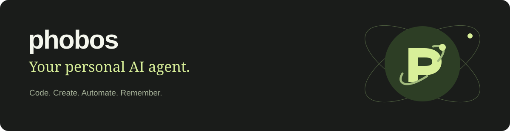
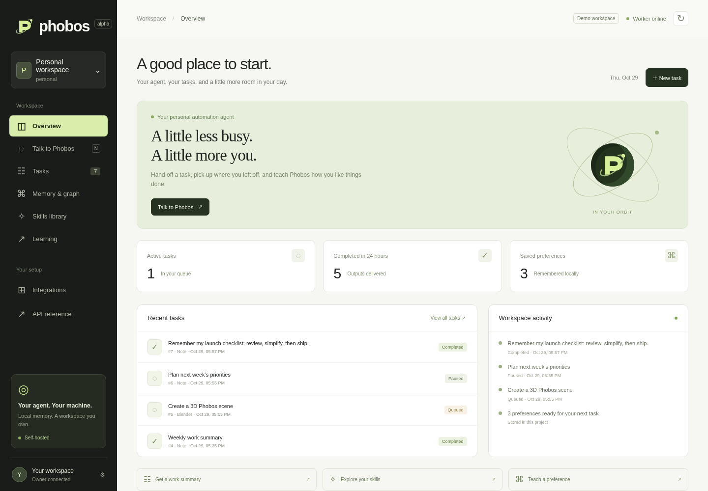

<p align="center"></p>

<p align="center"><strong>An AI helper that builds with you, creates with you, and gets better at your way of working.</strong></p>
<p align="center">Self-hosted · 70 skills · Graphify memory · Telegram · Creative workflows</p>

<p align="center"><a href="#what-can-you-do-with-phobos">Explore capabilities</a> · <a href="#get-started">Get started</a> · <a href="docs/DOCUMENTATION.md">Documentation</a> · <a href="docs/assets/phobos-dashboard-20s.mp4">Watch the demo</a></p>

[](docs/assets/phobos-dashboard-20s.mp4)

## Meet Phobos

Your coding assistant, creative companion, research helper and personal automation workspace—in one place you can host yourself.

Ask for help building a feature. Turn an idea into an editable motion graphic. Clip a recording. Keep a research notebook. Send a task from Telegram and follow its progress from your dashboard.

Phobos combines an agent workspace with an expanding library of skills and connected local memory. It can find new procedural knowledge, remember useful experience, and reuse the ways of working you have reviewed. You choose the model, the enabled tools and the machine it calls home.

**Build your own assistant around your life and your projects.**

## What can you do with Phobos?

### Build software and understand unfamiliar code

Work with Python, TypeScript, Go, Rust, React, databases and Docker. Use coding, debugging, review and architecture skills to move from a prompt to a tracked task and a useful result.

- Inspect project files, organize implementation notes and preserve architectural decisions.
- Use the optional Hermes or DSH agents for shell, browser, Git and native development workflows.
- Explore source relationships through Terrain or Graphify's local code indexing.
- Load **REA** guidance for investigating binaries, packaged apps and runtime evidence when its MCP server and analysis tools are configured.

> **Try:** “Help me understand this project, find the slow database queries, and draft a refactoring plan.”

### Create motion graphics and product videos

Bring ideas into motion with the bundled **huashu-motion** skill and optional runtime. Work on editable, code-based compositions for launch films, animated explainers and product demonstrations.

- Plan the message, storyboard, visual language and timing.
- Create an editable motion project, iterate on its source, and render an MP4.
- Keep the source so you can change the copy, colors and pacing later.
- Use the optional creative environment for the Node, Chromium and rendering tools.

> **Try with the creative/native-agent setup:** “Create a 20-second launch video for my app. Keep it editable and use my brand colors.”

### Design, work in 3D, and repurpose recordings

Use OpenDesign for supported visual generation and mockup workflows. Generate bounded Blender scenes, cut local recordings into clips, or prepare audio for transcription.

| Creative workflow | What it gives you | Setup |
|---|---|---|
| Motion graphics | Editable huashu-motion projects and MP4 exports | `om`, Node 22+, Chrome/Chromium |
| Visual design | Design generation and mockup bridge | Optional OpenDesign profile |
| 3D scenes | Editable `.blend` files and PNG previews from cube/sphere scene specifications | Blender |
| Video clipping | Local MP4 segments with chosen start time and duration | FFmpeg |
| Audio extraction | Mono 16 kHz WAV for speech workflows | FFmpeg |
| Transcription | Text or timestamped JSON from recordings | Optional Whisper extra and a local model |

> **Try:** “Cut the section from 00:45 to 01:15 out of my recording and prepare its audio for transcription.”

Creative commands and compatible workers perform the supported jobs. A skill supplies guidance; its external tools must also be installed. See [creative setup](docs/DOCUMENTATION.md#creative-tickets-and-optional-runtimes).

### Turn everyday requests into visible work

Keep ideas, requests and outcomes together instead of losing them in a chat history.

- Create tasks through the dashboard, CLI or Telegram.
- Follow their status, inspect event history, and download outputs.
- Pause queued work, resume it, cancel it, or retry a failed task.
- Save notes, organize research sources, maintain notebooks and get work summaries.
- Leave feedback on what was useful and what needs improvement.

> **Try:** “Save my launch checklist and show me what I completed in the last 24 hours.”

### Reach your agent through Telegram

Give Phobos a private bot and keep your workspace within reach when you are away from your computer.

- Send a message to create an assistant task.
- Check progress and retrieve results.
- Save preferences, recall related memories and discover skills.
- Send task notifications and daily work summaries to a configured channel.
- Restrict interaction to an explicit allowlist of Telegram user IDs.

```text
/new personal Help me plan this week's project priorities
/tasks
/status 12
/recall launch checklist
/skills motion
/report
```

Telegram credentials and channel access are configured by you. [Setup guide →](docs/DOCUMENTATION.md)

## It can learn new things—and keep the useful parts

Phobos improves through **new skills, remembered experience and reviewed procedures**. You can inspect the knowledge it keeps and decide which lessons deserve to become a repeatable workflow.

### Find knowledge it does not have yet

The agent searches its installed library first. If a relevant skill is missing, it can discover and download one from owner-approved online repositories. Downloads are pinned to a source revision and retain file hashes and licenses; installation does not run scripts or package hooks.

The bundled library includes **70 skills** across coding, design, motion, reverse engineering, research, planning, testing, security and operations.

### Remember more than the last conversation

**Graphify** connects project preferences, previous task outcomes, feedback, active procedures and skill usage in a local graph. Code indexing can add source-level relationships.

Before an assistant task, Phobos recalls relevant records and their connections. You can explore those memories in the dashboard, ask `/recall` from Telegram, inspect their sources, or remove an explicit preference.

### Turn good work into a better next attempt

1. **Give it a task.** Phobos uses the relevant skills and project context.
2. **Keep the outcome.** Results and skill usage become part of the project history.
3. **Give feedback.** Your latest review influences future skill ranking.
4. **Capture a reusable approach.** The agent or owner can propose a procedure draft.
5. **Review and activate it.** A passing owner-recorded evaluation makes the draft eligible for activation and future reuse.

**Learning changes the context and procedures used on future tasks; it does not retrain the underlying model.** Drafts and downloaded instructions do not automatically gain owner authority.

## Your agent. Your machine.

Run Phobos on your laptop, a home server, or a lightweight control plane designed for a **64-bit Raspberry Pi 4/5**. Keep local memory and workspace files on your own storage, choose your model gateway, and enable the services you need.

Use Tailscale Serve for private access from your other devices:

```sh
tailscale serve --bg http://127.0.0.1:8080
```

Heavy inference and creative tools can run on a more capable host using a configured gateway or a separate local installation. Automated remote worker dispatch is still pending. **Physical Raspberry Pi execution and ARM64 images are not yet certified.** [Hosting guide →](docs/DOCUMENTATION.md#raspberry-pi-and-tailscale)

## A dashboard for the whole workflow

| Workspace | What you can do |
|---|---|
| **Overview** | See recent work, completed outputs, preferences and worker status |
| **Talk to Phobos** | Create tasks, follow responses and give feedback |
| **Tasks** | Search, filter, inspect history and download outputs |
| **Memory & graph** | Save preferences and explore connected project experience |
| **Skills library** | Browse installed skills and discover additional guidance |
| **Learning** | Draft, evaluate, activate and retire reusable procedures |
| **Integrations** | See which optional capabilities are configured |

**[Watch the 20-second walkthrough](docs/assets/phobos-dashboard-20s.mp4).** The recording uses an isolated, labelled demo workspace and a real local note workflow. It does not show live model inference or live Telegram delivery.

## Get started

Requires Python 3.12+ and [uv](https://docs.astral.sh/uv/).

```sh
git clone https://github.com/Nirusaki-Malaal/phobos.git
cd phobos
uv sync --frozen
uv run phobos init
uv run phobos serve
```

Start the worker in another terminal:

```sh
uv run phobos worker
```

Open **http://127.0.0.1:8080**, select **Connect owner access**, and enter `PHOBOS_API_TOKEN` from your generated `.env`. The browser keeps the token in tab memory and clears it on reload.

Local notes and work reports run without a model. For assistant tasks, configure:

```dotenv
PHOBOS_MODEL=your-gateway-model-alias
PHOBOS_GATEWAY_URL=http://127.0.0.1:4000/v1
PHOBOS_GATEWAY_KEY=your-gateway-key
```

Core inference goes through the configured gateway. Optional native profiles retain their documented keyless Zen exceptions.

### Just explore the dashboard

```sh
uv run python scripts/demo-dashboard.py
```

Open **http://127.0.0.1:8094/?demo=1**. The script prints the location of a demo-only owner token. Sample data lives under `/tmp/phobos-dashboard-demo`, separate from your real application data.

### Use Docker and optional services

```sh
uv run phobos init                     # or configure .env from .env.example
make up                                # Phobos API + worker
make gateway-up hermes-up              # optional native agent
make terrain-up                        # optional code intelligence
make design-up                         # optional visual design

docker compose -p phobos --profile telegram up -d telegram
```

For the larger creative image:

```sh
docker compose -p phobos build api
docker compose -p phobos --profile creative build creative-worker
docker compose -p phobos --profile creative up -d creative-worker
```

Configure the corresponding `.env.example` settings before starting optional profiles. Creative rendering needs more resources than the core API/worker. Transcription separately requires the `transcription` Python extra and provisioned local model weights.

## Under the hood

Phobos combines a Python control plane, a local SQLite queue, bounded agent execution, a browser dashboard, Telegram, Graphify memory and procedural skill discovery. Optional **Hermes, DSH, LiteLLM, Terrain and OpenDesign** services extend the environment. All 54 original pai-stack skill bundles are retained alongside the additional Phobos and creative skills.

```text
src/phobos/        Agent, API, dashboard, workers, memory and Telegram
skills/            70 skill bundles, references and retained licenses
hermes/ · dsh/     Optional native agents and plugins
terrain/           Optional code-intelligence service
opendesign/        Optional visual generation service
llm-gateway/       Model routing and provider configuration
docker/            Core and optional creative Dockerfiles
scripts/           Demo, recording, model tooling and smoke checks
tests/             Core and integration regression coverage
docs/              Setup, architecture, migration and walkthrough assets
```

[Architecture](docs/architecture.md) · [Full documentation](docs/DOCUMENTATION.md) · [Migration](docs/MIGRATION.md) · [Porting details](docs/PORTING.md)

## Development and current status

**Alpha:** core workflows, the dashboard, local graph memory and skill management have regression coverage. The walkthrough exercises a live API → worker → local artifact flow.

```sh
make check
node --check src/phobos/static/dashboard.js
docker compose -p phobos --profile '*' config --quiet
```

Live model/Telegram checks, full native-service parity, real Blender/Whisper runs and complete creative-image verification remain separate validation targets. Voice/attachment ingestion, automated remote dispatch and physical Pi verification are still pending. A completed task means its workflow delivered an output; external actions need their own execution evidence.

Full shell, browser and Git workflows are supplied through the optional native agents. The lightweight core exposes bounded project tools.

The CI template is at `ci/verify-phobos.yml`. Copy it to `.github/workflows/ci.yml` with a workflow-authorized GitHub credential to enable Actions. To recreate the video, install Playwright/Chromium and FFmpeg, start the isolated demo and run `node scripts/record-dashboard.mjs`.

## License and credits

New Phobos code and original SVG branding are [MIT licensed](LICENSE). Reused services and skill bundles retain their upstream authorship, notices and terms. See [THIRD_PARTY_NOTICES.md](THIRD_PARTY_NOTICES.md) and the [pai-stack source map](docs/PORTING.md).
