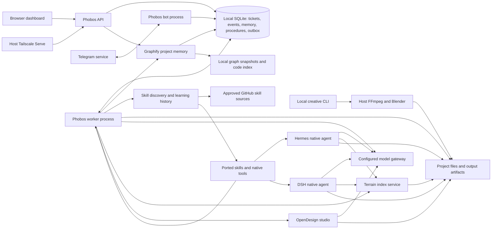

# Phobos architecture

One owner's local control plane. API, worker and bot are separate processes using the same application package and local SQLite volume. Each project has its own workspace directory. There is no mandatory rendering or inference runtime in the core image.

Ticket state and event/outbox writes share transactions. API routes do no model work. Workers claim one ticket at a time and run bounded model/tool loops. Bot delivery is at least once and retries independently from task execution. Memory is scoped by project and explicitly saved by the owner.

All original agent profiles, native tools and 54 skill bundles are ported, with 16 additional packs (70 total), including REA, huashu-motion and new coding guidance. The native agents keep their embedded memory stores; those databases are separate from Phobos's ticket database. Terrain remains the sole index writer. Its optional ACP and Hermes's OpenCode delegate retain the documented keyless Zen exceptions to gateway routing. Pi hosting is not hardware-certified. Creative jobs run through explicit CLI commands or compatible workers; core workers skip workflows whose native dependencies are absent. An optional creative-worker profile provides heavy rendering dependencies. Graphify snapshots live in the application data volume; Terrain remains the sole writer of .terrain indexes.

Owner-reviewed learning stores versioned drafts, evaluation records and activation state. The latest evaluation must pass before activation; a failed evaluation deactivates the procedure. Active procedures are scoped to the project and their IDs/versions are recorded in ticket events when loaded. Evaluation results are owner attestations, not automated benchmarks or model training.
